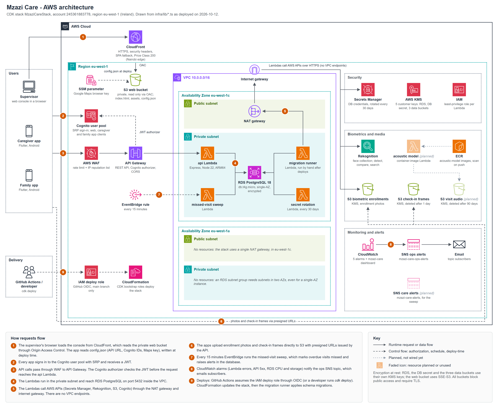
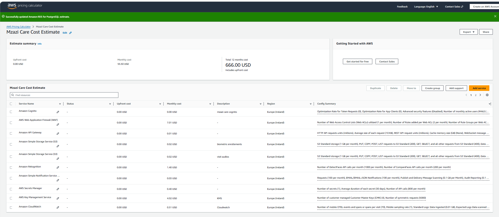

# Mzazi Care

Mzazi Care is a geo-verified visit tracking system for home caregivers in Kenya.
It lets a care agency prove that a scheduled visit happened at the right place, at the right time, with the right people present.
At check-in, the caregiver's phone checks it is within the dependant's home geofence, then scans a short-lived code shown on a family member's phone at the home.
If nobody from the family is there, a supervisor can start the visit, and it is reported as an exception.
During the visit the caregiver records their own voice and then the dependant's, and each recording is checked against that person's enrolled voiceprint.
The check is advisory: supervisors see the result and score, and it never stops a visit counting.
Check-out is confirmed the same way as check-in, with a code on the family member's phone, or the caregiver gives a reason and checks out at once.
Only the dependant's family can listen to the dependant's recording.
Supervisors plan each day's routes and monitor visits from a web console, caregivers check in and out with a mobile app, and family members follow their dependant's care from a second mobile app.

| Component | Path | Stack |
| --- | --- | --- |
| Supervisor web console | `frontend/web` | React 19, Vite, TanStack Query |
| Caregiver app | `frontend/mobile/caregiver` | Flutter |
| Family app | `frontend/mobile/family_member` | Flutter |
| API | `backend` | Node.js 22, Express 5, Drizzle ORM, PostgreSQL |
| Infrastructure | `infra` | AWS CDK (TypeScript), one stack: `MzaziCareStack` |
| Voice model | `acoustic-model` | Python. The frozen speaker-verification model runs in the system as a container Lambda (`voice_service/`); the cognitive model is research only and does not run |

The supervisor web console is live at **https://mzazicare.hmunene.com/**.

## Architecture



Everything runs in one AWS CDK stack in `eu-west-1` (Ireland), defined in `infra/lib/`.
The backend is serverless: three Node.js Lambda functions and one Python container Lambda for the voice check, so compute costs scale with use rather than running around the clock.

How a request moves through the system (the numbers match the diagram):

1. **Web console:** `Browser -> CloudFront -> S3 web bucket`.
   The bucket is private and readable only by CloudFront (Origin Access Control).
   At startup the app reads `config.json`, which CDK writes at deploy time with the API URL and Cognito IDs.
2. **Sign-in:** `App -> Cognito user pool` (SRP), which returns a JWT.
   Each app has its own Cognito app client.
3. **API calls:** `App -> AWS WAF -> API Gateway -> api Lambda`.
   WAF applies a rate limit and AWS's IP reputation list, and API Gateway's Cognito authorizer rejects requests without a valid JWT.
4. **Data:** `Lambda -> RDS PostgreSQL`, inside the VPC's private subnet.
5. **AWS APIs:** `Lambda -> NAT gateway -> internet gateway -> Secrets Manager / S3 / Cognito`.
   There are no VPC endpoints, so the single NAT gateway carries all of this traffic.
6. **Uploads:** `App -> S3` directly, using presigned URLs issued by the API, for visit recordings and voice enrolment.
   **Voice checks:** `api Lambda -> voice Lambda -> S3`. The voice Lambda has no VPC and no database access: it reads the recording and the voiceprint from S3 and returns a score, which the API stores. Only the API may invoke it.
7. **Missed visits:** `EventBridge (every minute) -> missed-visit sweep Lambda -> RDS` marks overdue visits as missed, raises alerts, and offers late visits to the nearest available caregiver.
8. **Operations:** `CloudWatch alarms -> SNS ops topic -> email` on Lambda errors, API 5xx responses, and high RDS CPU or low storage.
9. **Deploys:** `GitHub Actions (OIDC) or a developer -> IAM deploy role -> CloudFormation`, followed by the migration runner Lambda for schema changes.

Security and data protection:

- RDS, its credentials secret, the visit-audio bucket and the voiceprint bucket are encrypted with their own KMS keys.
- The database credentials live in Secrets Manager and rotate every 30 days.
- Every bucket blocks public access and rejects non-TLS requests.
- Visit audio is deleted after 90 days, and each listen is recorded in the audit log.
- Voiceprints are biometric data. They are made only with consent (terms v4), kept in their own bucket that only the voice Lambda can read, and deleted on re-enrolment or deactivation. Enrolment recordings are deleted once the voiceprint is made.
- The Lambdas and RDS sit in private subnets with no inbound route from the internet.

The diagram predates QR check-in and the voice Lambda, and still shows Rekognition.
The care alerts SNS topic is planned; alerts are in-app today.

## Cost estimate



Because the backend is serverless, the main fixed cost is the NAT gateway, which is billed hourly whether or not it carries traffic.
The estimate predates the web console hosting; at this project's traffic, its S3 storage and CloudFront requests add very little.

## Local development

Requires Docker, which runs PostgreSQL locally.

```bash
# From the repo root: start Postgres (host port 5433, not 5432 - see docker-compose.yml).
docker compose up -d

# One-time: create the disposable database the integration tests use.
psql -h localhost -p 5433 -U postgres -c "CREATE DATABASE mzazi_care_test;"
# Password: postgres (set in docker-compose.yml, local dev only).

cd backend
cp .env.example .env
npm install
npm run db:migrate
npm run db:seed    # optional: realistic sample data - users, caregivers, dependants, visits
npm run dev
```

`npm run db:studio` (from `backend/`) opens a browser-based database viewer.
`npm test` runs the unit and integration tests; the integration tests need `TEST_DATABASE_URL` (in `.env.example`) and skip themselves if it isn't set.

See `backend/drizzle/README.md` for migrations, and `backend/openapi.yaml` for the API contract.

### Running the web app

```bash
cd frontend/web
cp .env.example .env
npm install
npm run dev
```

It opens at `http://localhost:5173` and signs in against the deployed Cognito user pool.
`VITE_API_BASE_URL` in `.env` points at the local backend by default; set it to the deployed API URL to work against AWS instead.
The `VITE_*` values are only used by `npm run dev`; the hosted console reads its settings from `config.json`.

## Deployment

The whole stack, including the web console, deploys with the AWS CDK from `infra/`.
`cdk deploy` builds the web app first (the `build` step in `infra/cdk.json`), so the uploaded console always matches the code.

One-time setup: store the Google Maps browser key in SSM Parameter Store.

```bash
aws ssm put-parameter --name /mzazi-care/web/google-maps-api-key --type String --value "<key>" --region eu-west-1
```

In Git Bash, prefix that command with `MSYS_NO_PATHCONV=1`, or Git Bash rewrites the parameter name into a Windows path.

Each deploy:

```bash
cd infra
npx cdk diff      # review the changes
npx cdk deploy

# Straight after a deploy that adds migrations: apply them to RDS.
FN=$(aws cloudformation describe-stacks --stack-name MzaziCareStack --region eu-west-1 \
  --query "Stacks[0].Outputs[?OutputKey=='MigrationRunnerFunctionName'].OutputValue" --output text)
aws lambda invoke --function-name "$FN" --payload '{}' --cli-binary-format raw-in-base64-out --region eu-west-1 out.json && cat out.json
```

The stack's `WebUrl` output is the console's address.
If the CloudFront domain ever changes, add it to the Google Maps key's allowed HTTP referrers.
